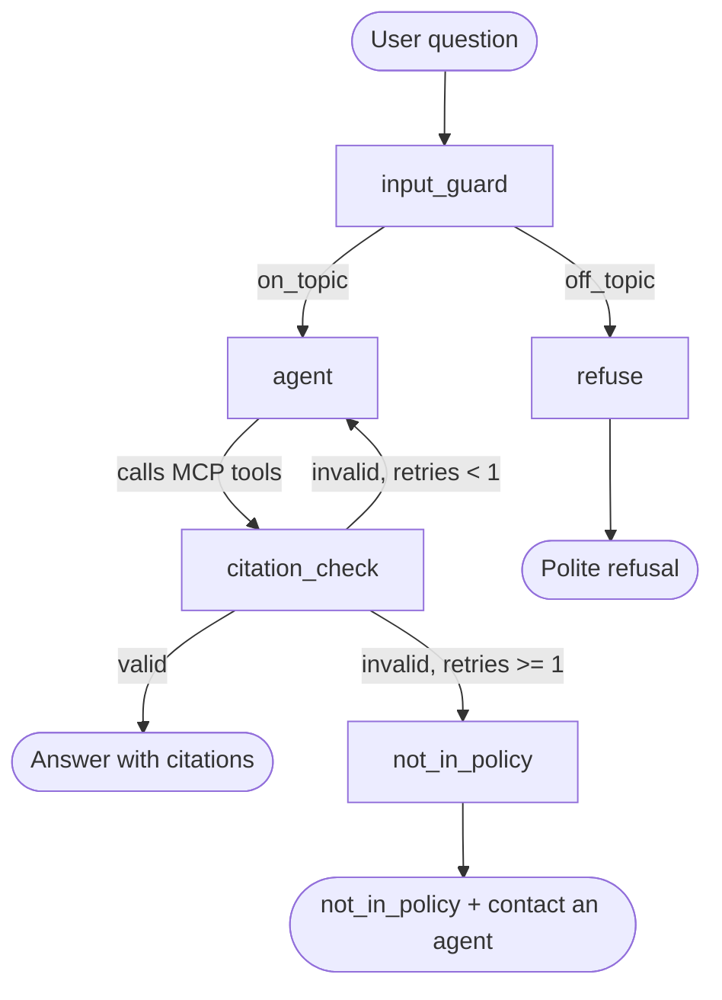

# PolicyGraph

> All insurance policies in this project are fictional and created for demonstration purposes only.

An AI agent that answers "Is this case covered by my insurance policy?" and cites the exact policy clauses behind every answer.

**I don't just build AI prototypes — I validate them with data.**

---

## Requirements (Stage 1 MVP)

### Functional
- The user asks a coverage question in free text (e.g. "My basement flooded from a burst pipe. Am I covered?").
- The system returns one of three verdicts: `covered`, `not_covered`, `not_in_policy`.
- Every `covered` / `not_covered` verdict includes the IDs of the policy clauses it is based on.
- If no relevant clause is found, the system returns `not_in_policy` and advises the user to contact an insurance agent. It never answers from general knowledge.
- Agent tools (`search_policy`, `check_claim`) are exposed through a dedicated MCP server.
- The agent is a single LangGraph agent with conditional routing and a retry after a failed guardrail check.

### Non-functional
- Response time: under 10 seconds per question (p95).
- Cost: $0 to run. LLM via Groq free tier, hosting on AWS free tier only.
- Deployment: FastAPI app in Docker on AWS Lambda.
- CI: tests run on every push via GitHub Actions.

### Guardrails
- **Input guard:** the first node of the graph classifies each request as `on_topic` or `off_topic`. Off-topic requests and prompt injection attempts never reach the agent.
- **Citation check:** after the agent answers, plain Python code verifies that every cited clause ID exists in the retrieved clauses. A failed check triggers a retry; a second failure returns `not_in_policy`.
- The system prompt restricts the agent to the policy text, but it is treated as a soft layer, not a guarantee (defense in depth).

### Evaluation
- A hand-labelled golden dataset (30–50 questions) with the correct verdict and correct clause IDs for each question.
- **Verdict metrics:** accuracy, confusion matrix, precision/recall per class.
- **Citation metrics:** citation precision and citation recall.
- Thresholds are set after the first baseline run.
- Stage 2 is compared against Stage 1 on the same dataset.

### Out of scope (MVP)
- User identity verification and access control.
- Claim payout calculation.
- Real customer data or real policies.
- Languages other than English.
- More than 3 policies (e.g. home, car, travel).
- Authentication and user accounts.
- A frontend beyond a minimal demo page.

## Architecture

- **input_guard** — classifies the request as on-topic or off-topic. Off-topic requests never reach the agent.
- **agent** — calls `search_policy` / `check_claim` on the MCP server and drafts a verdict with clause citations.
- **citation_check** — plain Python: every cited clause ID must exist in the retrieved clauses. On failure, the agent retries once with feedback about the invalid IDs.
- **not_in_policy** — returned when the answer cannot be verified after a retry.

## Roadmap
- **Stage 1:** RAG + MCP server + agent + guardrails + eval, deployed on AWS Lambda.
- **Stage 2:** policy clauses in a knowledge graph (Neo4j AuraDB Free), `query_graph` tool, RAG vs RAG+graph comparison on the same eval.